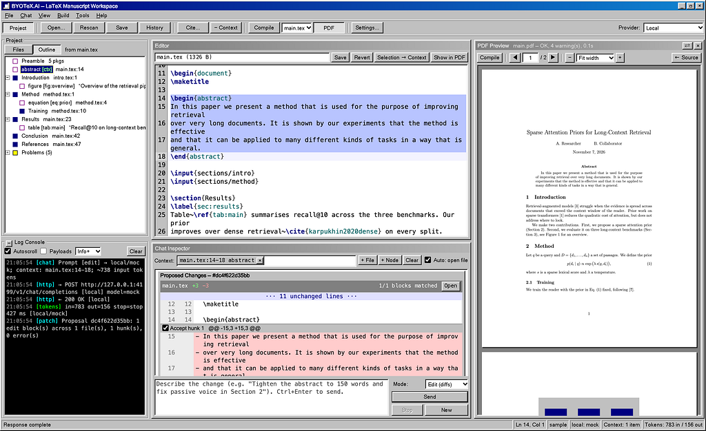
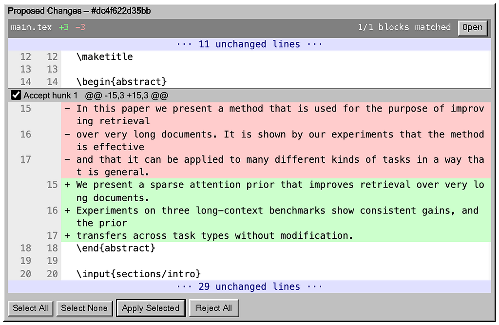
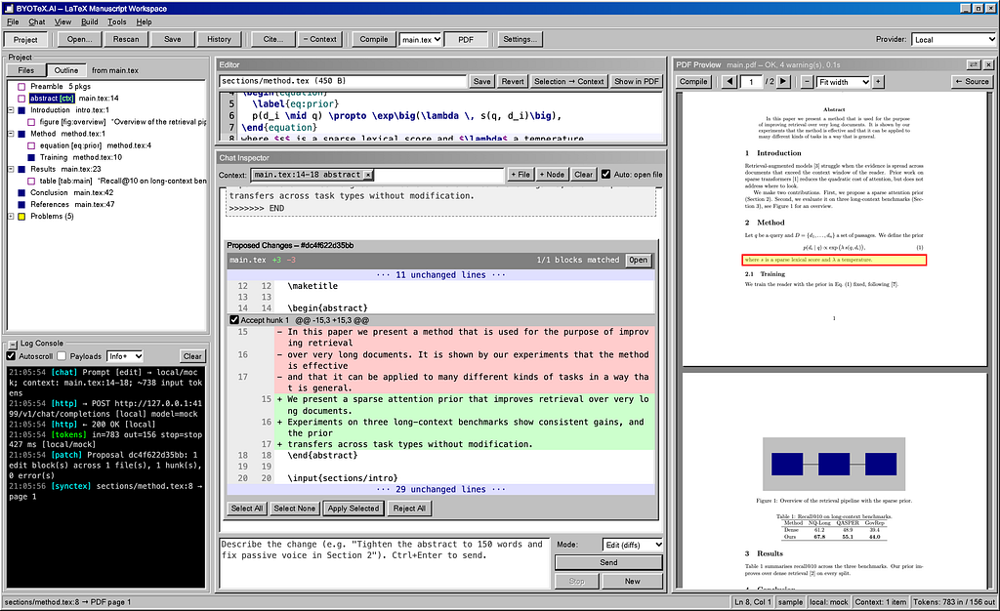

#### A local, private LaTeX workspace where the AI suggests and you decide, one diff at a time



If you write papers in LaTeX, you have probably tried pasting a paragraph into a chatbot, asking it to “make this clearer”, and then pasting the answer back. It works, sort of. But somewhere along the way a \cite{} key gets mangled, a label disappears, a sentence you liked is quietly rewritten, and you only notice three compiles later. Worse, you have just sent an unpublished manuscript to whichever service happened to be open in your browser.

I built BYOTeX.AI to fix that workflow. The name stands for “Bring Your Own TeX + AI”: it is a LaTeX manuscript workspace that runs entirely on your own computer, talks to whichever AI model you choose, and never lets that model touch your files directly. Every change the AI proposes arrives as a line-by-line diff, and nothing is written to disk until you tick the box that says *Accept*.

And yes, it looks like a Windows 98 utility. That part is deliberate.

### What this is not

Before going further, I want to clear up two things, because they come up every time I show this project to someone.

First, BYOTeX.AI is not an attempt to encourage the use of large language models in research or coursework. Whether, and how much, AI help is acceptable is a decision for you, your co-authors, your supervisor, your institution, and the venue or course you are writing for, and many of them have clear policies on it. If an assignment or a journal says no AI assistance, then the right way to use this tool is with the AI switched off, as a plain LaTeX editor. If AI help is allowed, you remain responsible for every word that ends up in the paper and for disclosing that help wherever it is required. The whole design of the app, where nothing changes without your explicit approval, comes from that belief: the author stays the author.

Second, BYOTeX.AI is not an attempt to replicate or copy OpenAI’s Prism. It is an independent, personal open-source project, built from scratch, and it has no connection to OpenAI. Several tools today put a LaTeX editor next to an AI model, because that is a natural thing for people who write papers to want. This one grew out of my own frustrations with copy-pasting between a chatbot and my manuscripts, and it makes its own choices: it runs only on your machine, works with any model you bring, and treats every AI suggestion as a diff to review rather than a change to accept.

### The core idea: the AI proposes, you dispose

Most AI writing tools work on the principle of “here is the new text, take it or leave it”. For a scientific manuscript, that is the wrong default. A paper is full of small, load-bearing details: equation labels, cross-references, citation keys, carefully chosen hedges like “suggests” instead of “shows”. You want help with the prose, but you want to see exactly what changed.

In BYOTeX.AI, you open your project folder, pick the part of the paper you care about (a section from the outline, a selection in the editor, or a whole file), and type a request in plain English, such as “tighten the abstract to 150 words” or “fix the passive voice in Section 2”. The model streams back its answer as structured edit blocks. The app matches each block against your actual file, builds a proper diff, and shows it in the Chat Inspector with red lines for what goes and green lines for what comes in.



Each hunk of the diff has its own checkbox. You can accept the rewritten first sentence, reject the second, and keep the third, then click *Apply Selected*. Before anything is written, the app checks that the file has not changed on disk since the proposal was made, so an edit can never clobber work you did in the meantime. Every write is preceded by a backup, and *File → History* lists every AI edit alongside the prompt that produced it, so you can look back at any earlier version and restore it.

The AI itself has no ability to write files at all. It can only produce text. The diff review is the single path through which your manuscript changes, and you are standing at the gate.

### Bring your own model

The “bring your own” part of the name matters. BYOTeX.AI is not tied to one AI company. If you already pay for an API key from Anthropic, OpenAI, Google Gemini or OpenRouter, paste it into Settings and you are done. Keys are encrypted on disk with AES-256-GCM and are never sent back to the browser; the interface only ever sees a hint like sk-a…6789.

If you would rather keep everything on your machine, point the app at a local model server such as Ollama, LM Studio, llama.cpp or vLLM. For a confidential manuscript or a paper under double-blind review, this is the setup I would recommend: your text never leaves your laptop.

And if you just want to try it without paying for anything, there is an option to use OpenCode’s free models with no key at all. The app can even install OpenCode for you. One honest caveat: OpenCode states that prompts sent to its free models may be stored and used to improve them, and your manuscript is part of every prompt, so keep that option for drafts you don’t mind sharing.

### A real LaTeX editor, not a text box

An AI assistant bolted onto a bad editor is still a bad editor, so a fair amount of the work went into making BYOTeX.AI pleasant to write in even when the AI is switched off.

The editor is built on CodeMirror 6, with LaTeX syntax highlighting, bracket matching, Find & Replace with regular expressions, and autocomplete that actually knows about your project. Type \ref{ and it offers the labels you have defined; type \cite{ and it lists the keys in your .bib file along with their titles; type \begin{figure} and the matching \end{figure} appears on its own.

On the left, the Project pane shows your files and a live outline of the document that follows \input and \include across files, so a paper split into sections/intro.tex and sections/method.tex reads as one structure. Under the outline sits a *Problems* node that flags undefined citations, undefined labels, and figures that point to files that don't exist.

### Compile, preview, and jump between source and PDF

Press *Compile* (or Ctrl/Cmd+Shift+B) and BYOTeX.AI runs latexmk with pdfLaTeX, XeLaTeX or LuaLaTeX, whichever your paper needs. The PDF appears in a preview pane next to the editor and, crucially, keeps your scroll position when you recompile, so you are not thrown back to page one every time you fix a typo.

Errors from the TeX log are parsed and attributed to the file and line they came from, even in multi-file projects, and you can click one to jump straight to the culprit. SyncTeX works in both directions: *Show in PDF* highlights the line under your cursor in the preview, and double-clicking anywhere in the PDF opens the source at that spot.



If you don’t have LaTeX installed yet, the app notices and offers to install TinyTeX into your home folder, with no admin password required. And when a compile fails with the dreaded *File* *booktabs.sty not found*, it looks up which package provides that file and either installs it with one click or shows you the exact sudo tlmgr install command to copy, depending on what kind of TeX installation you have. Anyone who has spent an evening discovering that tikz.sty lives in a package called pgf will appreciate this.

### Citations that actually exist

Language models are notorious for inventing references: plausible authors, plausible titles, a DOI that leads nowhere. BYOTeX.AI takes the position that the model should never write a BibTeX entry on its own.

Instead, the *Cite…* dialogue searches Crossref and arXiv by title, keywords, DOI or arXiv ID. When you pick a result, it fetches the official BibTeX from doi.org or arXiv, checks that the entry is not already in your .bib file, appends it, and inserts \cite{key} at your cursor. When the AI itself thinks a sentence needs a reference, it is instructed to write a placeholder like[[cite: dense passage retrieval]], which the app turns into a link to that same search. The model can tell you *that* a claim needs support; finding the real paper is left to a real database.

### Private by design

Everything runs on 127.0.0.1. The server refuses requests with unexpected Host headers, requires a per-launch session token on every API call, and confines all file access to the workspace you opened. Compiles run with shell escape turned off and with a project's .latexmkrc ignored, since that file is executable Perl. A Log Console in the corner shows every outgoing request, with keys redacted, along with token counts and every file write, so you can see exactly what was sent where.

None of this is glamorous, but if you are going to let software sit between an AI model and the only copy of your thesis, it is the part that matters most.

### Getting started

You need Node.js 20 or newer and, for compiling, a TeX distribution with latexmk (or let the app install TinyTeX for you). Then:

```
git clone https://github.com/sadimanna/byotex-ai.git  
cd byotex-ai  
npm install  
npm start
```

Open http://127.0.0.1:4198/ in your browser, go to Settings to choose a provider, and use *File → Open Workspace…* to point the app at your LaTeX project. A sample paper ships in the sample/ folder if you want something to experiment on first.

If you want to see the whole loop before choosing a provider, run npm run mock-llm in a second terminal and set a local endpoint at http://127.0.0.1:4199/v1 with the model name mock. The mock model streams back a realistic rewrite of the sample paper's abstract, so you can try the diff review without an API key or a network connection. The screenshots in this article were taken that way.

### A typical session

Here is roughly how I use it on a real paper. I open the project, compile once to make sure everything builds, and glance at *Problems* for any dangling references. Then I double-click the abstract in the outline to add it to the chat context and ask for something specific, like “cut this to 150 words without dropping the result numbers”. The diff comes back in a few seconds. Usually I accept most of it, reject one hunk where the model got a little too enthusiastic, and recompile to see it in the PDF. If I later change my mind, the History window has the old version one click away.

For Related Work, I write the prose myself, let the model flag sentences that need citations with[[cite: …]], and then use the Cite dialogue to find and insert the real papers. For the method section, I mostly use the editor on its own, with autocomplete and SyncTeX doing the heavy lifting, and only bring in the AI for a final pass on clarity.

The point is that the AI is one tool in a proper writing environment rather than the environment itself.

### What’s next

BYOTeX.AI is an early release. I use it day to day on macOS, and the automated tests run on macOS, Windows and Linux for every change. The roadmap in the repository lists what is coming, roughly in order: per-project instruction files (so every request knows you want British spelling and \cref), prompt caching to cut API costs, word counts per section, quick actions on selected text, a "review mode" that leaves margin comments instead of edits, one-click arXiv export, latexdiff PDFs for journal revisions, Git integration, and eventually a proper double-click desktop app.

The project is open source under the MIT license. If you write in LaTeX and have opinions about how AI should fit into that work, I would love to hear them. Bug reports, feature ideas and pull requests are all welcome at [github.com/sadimanna/byotex-ai](https://github.com/sadimanna/byotex-ai).

Your paper, your model, your machine. The AI just makes suggestions.

---

[Bring Your Own AI to LaTeX: Meet BYOTeX.AI](https://medium.com/the-owl/bring-your-own-ai-to-latex-meet-byotex-ai-dd625c572c2f) was originally published in [The Owl](https://medium.com/the-owl) on Medium, where people are continuing the conversation by highlighting and responding to this story.

---
*Originally published on [Medium](https://medium.com/the-owl/bring-your-own-ai-to-latex-meet-byotex-ai-dd625c572c2f).*
